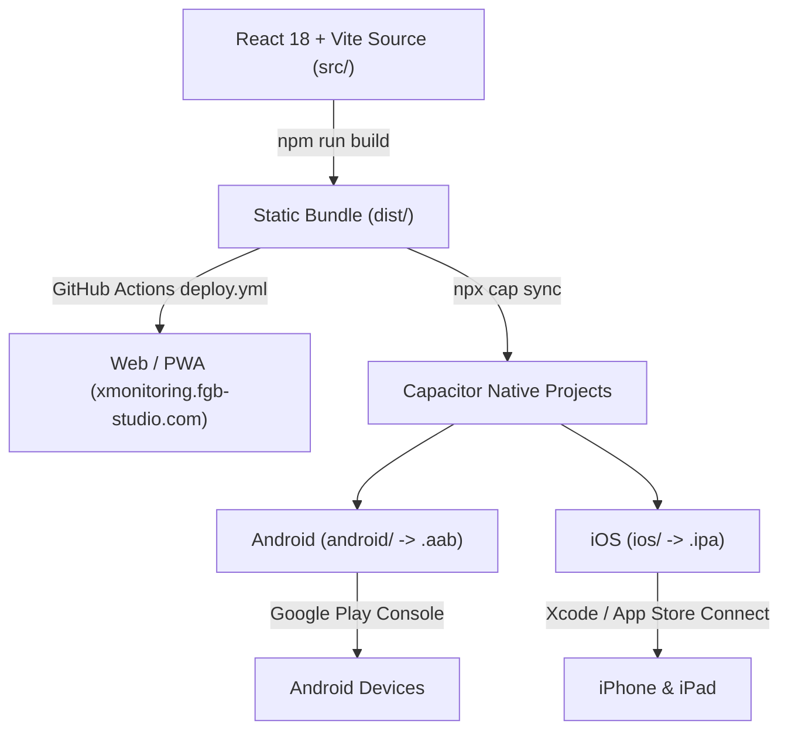
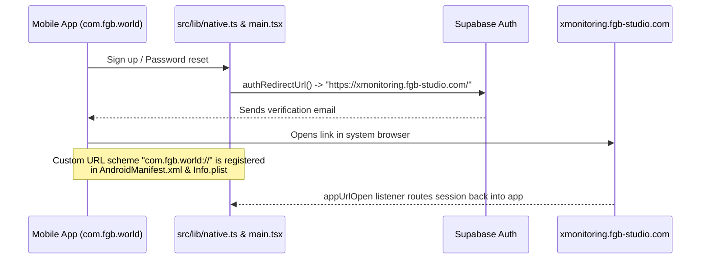

# FGB Monitoring — Mobile Architecture, Setup & Store Readiness Guide

> **Last Updated:** November 2026  
> **App Name:** `FGB`  
> **Bundle ID / Application ID:** `com.fgb.world`  
> **Version:** `1.0` (Android `versionCode: 1`, iOS `CURRENT_PROJECT_VERSION: 1`)  
> **Mobile Stack:** Capacitor `8.3.x` (iOS + Android) + PWA (`vite-plugin-pwa` `1.3.0`)  

This document is the English source of truth for FGB Monitoring's mobile architecture, build workflow, Privacy Policy status, and App Store / Google Play readiness.

---

## 1. What the App Is & Tech Stack

**FGB Monitoring** is an enterprise B2B smart-building intelligence platform for luxury retail holdings and facility teams. It monitors real-time **Energy (kW / kWh)**, **Indoor Air Quality (CO2, TVOC, PM2.5, PM10, Temp, Humidity)**, **Water**, and **LEED / WELL Certifications** across global store portfolios.

### Core Technology Stack
| Layer | Technology | Details |
|---|---|---|
| **Frontend UI** | React 18, TypeScript, Vite 5, Tailwind CSS, shadcn-ui | Single-page app with dedicated mobile views (`OverviewMobileView`, `MobileModuleDashboard`) |
| **Maps & Charts** | Leaflet (`leaflet.markercluster`), Recharts | Interactive world/region/brand map + site telemetry charts |
| **Backend & Auth** | Supabase (PostgreSQL, Auth, Edge Functions) | Multi-tenant RLS (`user_memberships`, `user_roles`), `delete-account` Edge Function |
| **Web / PWA** | `vite-plugin-pwa` (`1.3.0`, Workbox) | `registerType: "autoUpdate"`, offline shell caching, `/install` onboarding |
| **Native Wrapper** | Capacitor `8.3.1` (`android/` & `ios/` committed) | Bundles local `dist/` static build directly inside the native binary (no external `server.url`) |
| **OTA Updates** | *Not installed* | Native updates ship through standard Apple App Store & Google Play releases |

### Installed Native Capacitor Plugins
| Package | Version | Purpose |
|---|---|---|
| `@capacitor/core` / `cli` / `android` / `ios` | `^8.3.1` | Native WebView runtime & platform projects |
| `@capacitor/app` | `^8.1.1` | Deep link handling (`appUrlOpen`) & Android hardware back button (`fgb:back`) |
| `@capacitor/haptics` | `^8.0.2` | Tactile feedback (`hapticLight`, `hapticMedium` in `src/lib/native.ts`) |
| `@capacitor/filesystem` | `^8.1.2` | Writing generated PDF reports to device storage |
| `@capacitor/share` | `^8.0.1` | Native OS Share Sheet for exporting PDF reports |
| `@capacitor/splash-screen` | `^8.0.1` | 2000ms corporate dark splash (`#002838`) |
| `@capacitor/status-bar` | `^8.0.2` | Dark status bar styling (`#002838`) |

---

## 2. Architecture & Flow Diagrams

### 2.1 Dual Distribution Architecture (Single Codebase -> Web/PWA & Native)



### 2.2 Native Runtime, Auth & Deep-Link Flow

Inside a native WebView, `window.location.origin` is `capacitor://localhost` (iOS) or `http://localhost` (Android), which cannot receive email confirmation links. `src/lib/native.ts` and native manifests solve this as follows:



### 2.3 Local Build & Native Sync Flow

```
[Code Changes in src/]
         │
         ▼
   npm install          (if dependencies changed)
         │
         ▼
   npm run build        (compiles TypeScript + Vite into dist/)
         │
         ▼
   npx cap sync         (copies dist/ into android/ & ios/ + syncs native plugins)
         │
         ├─────────────────────────────┐
         ▼                             ▼
 npx cap open android          npx cap open ios (macOS only)
 (Android Studio -> .aab)      (Xcode -> Product > Archive)
```

---

## 3. Native Platform Configuration Details

### Android (`android/`)
- **`applicationId` / `namespace`:** `com.fgb.world` (`android/app/build.gradle`)
- **SDK Targets (`android/variables.gradle`):** `minSdkVersion = 24`, `compileSdkVersion = 36`, `targetSdkVersion = 36`
- **Versioning:** `versionCode 1`, `versionName "1.0"`
- **Permissions (`AndroidManifest.xml`):** Only `INTERNET` (minimal footprint; no invasive camera/location permissions)
- **Deep Link Scheme:** `@string/custom_url_scheme` (`com.fgb.world://`)
- **Signing:** Release keystore (`.jks`) is **not** committed in the repo and must be generated/stored securely during release build.

### iOS (`ios/`)
- **`PRODUCT_BUNDLE_IDENTIFIER`:** `com.fgb.world` (`project.pbxproj`)
- **Versioning:** `MARKETING_VERSION = 1.0`, `CURRENT_PROJECT_VERSION = 1`
- **Export Compliance (`Info.plist`):** `ITSAppUsesNonExemptEncryption` is already set to `false`
- **Orientations:** Portrait on iPhone; all 4 orientations on iPad
- **Deep Link Scheme:** `CFBundleURLSchemes` includes `com.fgb.world`
- **Signing:** Requires Apple Developer Team + Distribution Certificate & Provisioning Profile in Xcode on macOS.

### Store Compliance Features Already Implemented
- **In-App Account Deletion:** `UserAccountDropdown.tsx` invokes the `delete-account` Supabase Edge Function (`supabase.functions.invoke('delete-account')`), satisfying Apple App Store Guideline 5.1.1(v).
- **No Unapproved Dynamic Code Loading:** `capacitor.config.ts` bundles static `dist/` locally (no `server.url` pointing to an external preview).

---

## 4. Privacy Policy Status (Audit)

**Do we already have a Privacy Policy?** **Yes — updated with verified company details, pending git commit/deployment & in-app link.**

What exists in the repository (currently **untracked local files**):
- `PRIVACY_POLICY.md` — Full GDPR-compliant notice for **FGB Studio Italy S.r.l.** (P.IVA `12634970961`, Via Monte Napoleone n. 23 – 20121 Milano (MI), Italy; D-U-N-S `442810108`; PEC `fgbstudiosrl@pec.it`; Emails: `fgb@fgb-studio.com` / `monitoring@fgb-studio.com`; Effective Date: `November 2026`; Supabase EU Frankfurt confirmed).
- `public/privacy.html` — Styled standalone HTML version intended to be served publicly at `https://xmonitoring.fgb-studio.com/privacy.html`.

### Remaining Privacy Policy Actions Before Store Submission
1. **Commit & deploy `public/privacy.html`:** Currently untracked in git (`git status`) and not pushed to `main`. Until deployed, `https://xmonitoring.fgb-studio.com/privacy.html` will return **404** (both Apple and Google reject submissions with a broken Privacy Policy URL).
2. **Add an in-app Privacy Policy link:** Searching `src/` shows no link to `/privacy.html` on the login screen or account menu. Apple App Store and Google Play expect an accessible Privacy Policy link **inside the app** as well as on the store listing.
3. **Sub-processor & AI/CCPA alignment (Sentry, Push, AI Chatbot):** `PRIVACY_POLICY.md` and `public/privacy.html` already include **Sentry** and **Firebase FCM / Apple APNs** in anticipation of the 6-day implementation sprint below.
   - **Important note on AI Chatbot & ML:** If we add an **AI Chatbot** (or ML insights/chat) before launch, we **must update `PRIVACY_POLICY.md` and `public/privacy.html`** to add: (a) an AI Chat & ML data-processing clause (covering prompts, chat history, and site telemetry), and (b) the external LLM sub-processor (e.g., OpenAI, Google Gemini, Anthropic, or AWS Bedrock).
   - **Optional US/CCPA note:** If clients have US stores (e.g. California), consider adding a short CCPA/CPRA non-sale disclosure in Section 9.

---

## 5. Are We 100% Ready to Pay & Submit?

### A. Ready to pay Apple ($99/yr) and Google Play ($25 one-time) NOW? — **YES**
You can pay and start both developer account enrollments **immediately**:
- You already have the required legal entity & D-U-N-S number (**FGB Studio Italy S.r.l.**, P.IVA `12634970961`, D-U-N-S `442810108`) for Apple Developer Organization verification.
- Paying early is recommended because **Apple Organization verification and Google Play identity verification take 2–5 business days**.

### B. Things To Do Before Client Release & Store Submission (6-Day Target)

| Item | Status | Action Needed |
|---|---|---|
| App code, `dist/` build & Capacitor `8.3` | **Ready** | Verified building cleanly (`npm run build`) |
| Bundle ID (`com.fgb.world`) & SDK targets | **Ready** | Unified across `capacitor.config.ts`, Android (`targetSdk 36`), and iOS |
| Native app icons & splash screen | **Ready** | Generated in `android/app/src/main/res/` and `ios/App/App/Assets.xcassets/` |
| In-app account deletion (`delete-account`) | **Ready** | Implemented in `UserAccountDropdown.tsx` |
| **1. Deploy Privacy Policy** | **To Do** | Commit & push `public/privacy.html` + `PRIVACY_POLICY.md` so `https://xmonitoring.fgb-studio.com/privacy.html` is live |
| **2. In-app Privacy Policy link** | **To Do** | Add a clickable Privacy Policy link in `Auth.tsx` / `UserAccountDropdown.tsx` |
| **3. Sentry Crash & Error Tracking** | **Done (Live & Verified)** | `@sentry/react` v11 (`dataCollection` PII disabled + `beforeSend` scrubbing + offline IndexedDB transport) & `@sentry/vite-plugin` live on `origin/main` (`c8ef7b6`). EU project (`fgb-studio` / `javascript-react`), privacy filters, and rate limit configured; live localhost event verified (`#163383347`) and **44 hidden source-map files** verified uploaded in Sentry CI (`0.0.0 (c8ef7b6)`) |
| **4. Mobile Push Notifications (FCM & APNs)** | **To Do (6-day goal)** | Install `@capacitor/push-notifications`, set up Firebase (`google-services.json` for Android) + Apple `.p8` key (iOS), store device tokens in Supabase, and wire alert dispatch |
| **5. AI Chatbot (Optional / Potential)** | **To Do (6-day goal)** | Decide scope/provider; if included in v1.0, implement UI + backend proxy and disclose the LLM sub-processor in the Privacy Policy |
| **6. Android release keystore (`.jks`)** | **To Do** | Generate in Android Studio when building the signed `.aab` (back up `.jks` + passwords safely) |
| **7. macOS + Xcode build for iOS** | **To Do** | Run `npm run build && npx cap sync && npx cap open ios` on a Mac to sign & archive to TestFlight |
| **8. Store assets & reviewer demo login** | **To Do** | Prepare store screenshots, Play Store feature graphic (1024x500), descriptions, and a dedicated non-admin demo user account for Apple/Google reviewers |

---

## 6. Next Steps & Publishing Timeline

| Phase | Tasks | Owner | Est. Time |
|---|---|---|---|
| **1. Pay & Enroll Accounts (Start Now)** | Pay Apple Developer Program ($99/yr, D-U-N-S `442810108`) and Google Play Console ($25) and complete organization identity verification | Admin / Owner | Days 1–5 (parallel verification) |
| **2. Feature & Compliance Sprint (6-Day Goal)** | ~~Sentry~~ (live & CI source maps verified), implement **Push Notifications (FCM + APNs)**, optional **AI Chatbot**, add in-app Privacy Policy link, and commit/push `public/privacy.html` | Dev | Days 1–6 |
| **3. Store Listing Assets & Demo User** | Create store screenshots (iPhone 6.7", iPad, Android), Play Store 1024x500 banner, store copy, and a demo login account for reviewers | Design / Admin | Days 4–6 |
| **4. Signed Builds & Internal Beta** | Generate Android keystore + signed `.aab` -> **Play Internal Testing**; archive iOS build on Mac -> **TestFlight**; test auth, push, Sentry, telemetry & PDF share on real devices | Dev + QA | Days 6–7 |
| **5. Submit & Store Review** | Submit store listings + builds; Apple review typically takes 24–48h, new Google Play org accounts typically take 2–7 days | Apple / Google | 2–7 days |

---

## 7. Quick Reference Commands

```bash
# Install dependencies, build production bundle, and sync native projects
npm install
npm run build
npx cap sync

# Open native IDEs
npx cap open android    # Build > Generate Signed Bundle / APK (.aab)
npx cap open ios        # macOS only: Product > Archive -> App Store Connect

# Diagnostics
npx cap doctor
```
